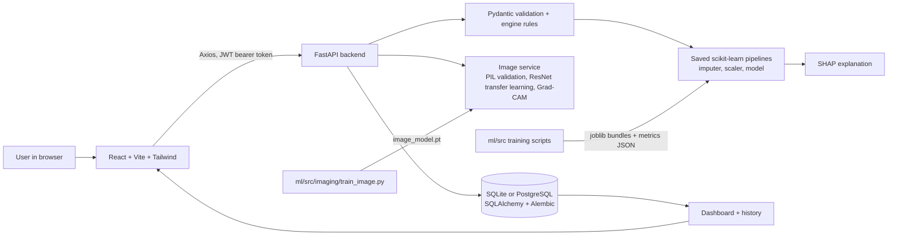

# Architecture

## Data flow for one tabular screening
1. The form (generated from `GET /api/v1/diseases`) validates input in the browser.
2. `POST /api/v1/screening/{disease}` with a bearer token. Pydantic checks types (strings and booleans rejected); `engine.validate_record` enforces per-feature ranges, allowed codes and which fields may be blank.
3. The saved pipeline imputes blanks with training medians, scales, scores. SHAP computes contributions from the same model.
4. The record (inputs, score, flag, warnings, explanation, model version) is saved for the signed-in user; an audit event is written (without inputs).
5. The result page loads the record by id, so what the user sees is what was stored.

## Training versus prediction
Training (offline): load and validate data, stratified split, tune by CV on the training set only, select on validation, test once, save the bundle and metrics. Prediction (online): validate, load the cached bundle, score, explain. Preprocessing objects are part of the saved pipeline, so the two cannot drift apart.

## Modules
`ml/src/modules.py` is the registry: each module declares its dataset loader, feature definitions (labels, ranges, codes, which may be blank) and file paths. A new tabular disease needs a loader and a feature list, then `python src/train_module.py <slug>`; the API and form pick it up automatically.

## Image path
Upload (multipart) -> size limit (5 MB) -> content-based validation (PNG or JPEG decoded by Pillow, dimension and pixel limits) -> resize/normalise -> ResNet (ImageNet-pretrained, last block fine-tuned) -> softmax score -> Grad-CAM on `layer4` -> overlay returned once. Only a SHA-256 fingerprint, size and score are stored.
The route exists only if a trained model file is installed when the server starts.

## Security controls actually implemented
bcrypt password hashing; JWT with expiry; per-user record isolation with an admin scope; strict input validation; CORS allow-list; in-memory rate limiting; no stack traces or submitted values in error bodies; secrets only from environment variables; audit trail without patient inputs; users can delete their records.
